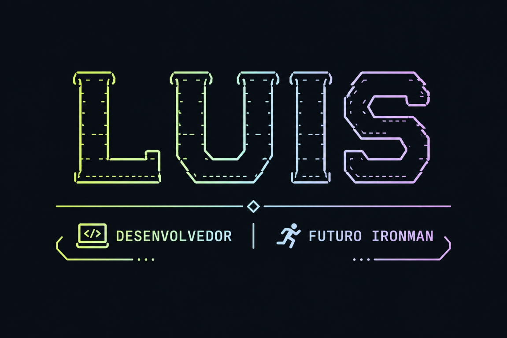

<!-- ==================== HEADER ==================== -->

<p align="center">
  
</p>

<!-- ==================== BANNER ==================== -->

<p align="center">
  
</p>

<!-- ==================== SOCIAL ==================== -->

<p align="center">

  <a href="https://www.instagram.com/luisnanddo">
    
  </a>

  <a href="mailto:77luisnando@gmail.com">
    
  </a>

  

</p>

<br>

<!-- ==================== ABOUT ME ==================== -->

<h2 align="center">👋 About Me</h2>

```yaml
name: Luis Fernando
role: Software Developer 💻
focus: Building useful software from everyday ideas ✨
likes: Running 🏃 · Open Source 🔓 · Technology 💻 · Coffee ☕
projects: Finance · Healthcare · Developer Tools
learning: C# · .NET · TypeScript · React · Python
superpower: Turning everyday needs into software solutions 🚀
```

---

<!-- ==================== TECHNOLOGIES ==================== -->

<h2 align="center">🛠️ Technologies</h2>

<p align="center">
  
</p>

---

<!-- ==================== PROJECTS ==================== -->

<h2 align="center">🚀 Featured Projects</h2>

<p align="center">
  ⭐ <em>Star a repo if you like it — it helps fuel my next PR 🏃</em>
</p>

<table align="center">
<tr>

<td width="45%" valign="top" align="center">

### 💰 [Liora](https://liora-rho.vercel.app)

A personal finance application built to make everyday financial management simpler, more organized, and easier to understand.

**React · TypeScript · Vite**

✔ Income and expense tracking

✔ Transaction history

✔ Custom categories

✔ Financial dashboard

⏳ Monthly reports

</td>

<td width="10%"></td>

<td width="45%" valign="top" align="center">

### 🏥 awesome-healthcare-brasil

A curated Markdown resource documenting tools, libraries, APIs, standards, and references for healthcare system developers in Brazil.

✔ Healthcare development resources

✔ Security, LGPD, and interoperability

✔ SUS and DATASUS documentation

✔ HL7, FHIR, and DICOM standards

✔ APIs and Open Source projects

</td>

</tr>
</table>

---

<!-- ==================== FOOTER ==================== -->

<p align="center">
  
</p>
